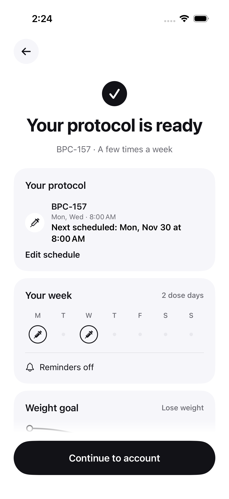
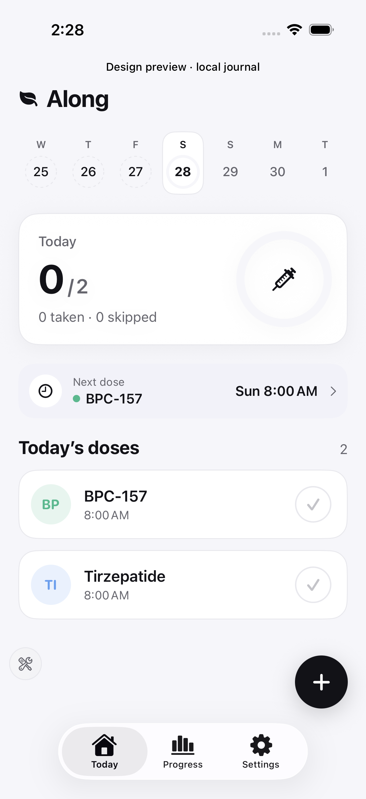
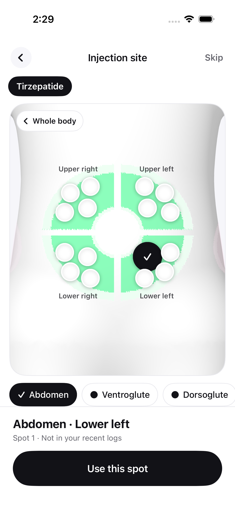
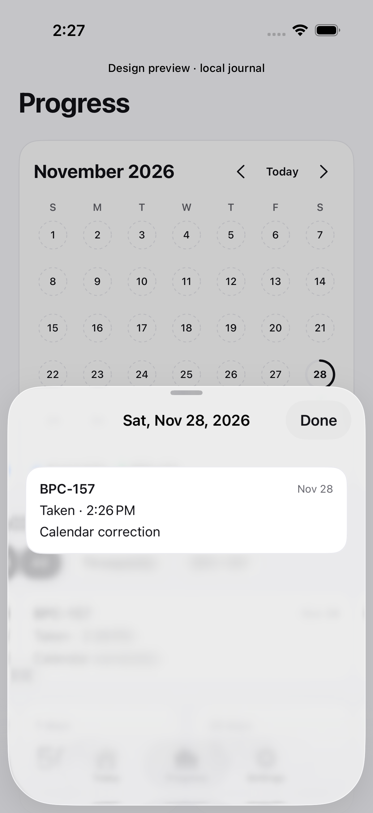
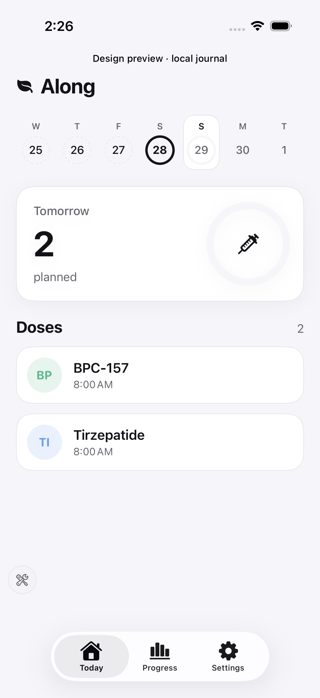

# Walk through Along on iPhone

Along helps someone following their own protocol answer three questions: what’s due, what did I record, and when is the next one? These screens were captured from the SwiftUI app on an iPhone simulator. They use a fictional journal.

## 1. Choose a schedule

Choose **Set up my tracker** for the short route. Confirm you’re 18 or older and select the peptide you want to track. **Walk me through Along** opens the longer guided introduction. New users can take either route without entering their date of birth.

| What you know today | What Along shows before checkout |
| --- | --- |
| Your peptide, day and time | Your schedule, optional reminders, an optional previous injection, and the next scheduled occurrence. |
| Your peptide only | Choose **Set my schedule later**. You can still record a previous injection. The plan has no due time. |
| You’ll add a peptide later | **Add a peptide later** opens the empty plan. Once you enter Today, **Add a peptide** starts the first entry. |

## 2. Record today’s dose

Tap the circle beside a scheduled peptide to mark it taken. Today shows the time you recorded it. Tap the same circle again to undo. Tap the row when you want to record a skip or add a time, an amount, a site or a note. You can save an entry with those optional details blank. When you log an extra dose and track multiple peptides, choose which one it belongs to.

| Today | Optional injection site |
| --- | --- |
|  |  |

## 3. Find and correct a record

Open **Progress**, tap the calendar date, then the entry. Edit it and save. The calendar and history show the corrected record, including after you quit and reopen Along. If the next scheduled entry is tomorrow, tapping it on Today opens that day’s plan.

| An entry opened from the calendar | Upcoming day |
| --- | --- |
|  |  |

## Try the build

[Open the verified iPhone Simulator build and screenshots](https://github.com/IbraaheemRashid/along/actions/runs/46153005387/artifacts/15267733453). Unzip the download and then unzip `Along-iPhone-Simulator.zip`. With an iPhone Simulator open on an Apple silicon Mac, drag `Along.app` onto it. You can also run the **Along** scheme from [the Xcode project](../apps/ios/Along.xcodeproj).

Complete setup and choose **Open design preview** on the paywall to explore a labelled local journal. The account walkthrough used a local StoreKit subscription. It created a disposable account, recorded a dose, read the saved dose directly from the account backup, deleted the account in Settings and verified that both the login and backup were gone. A separate returning user requested a password reset and signed in with the new password. The downloadable default build saves its journal on the simulator.

[Verification run](https://github.com/IbraaheemRashid/along/actions/runs/46153005387) · [Research and design decisions](tracking-ux-research.md)
